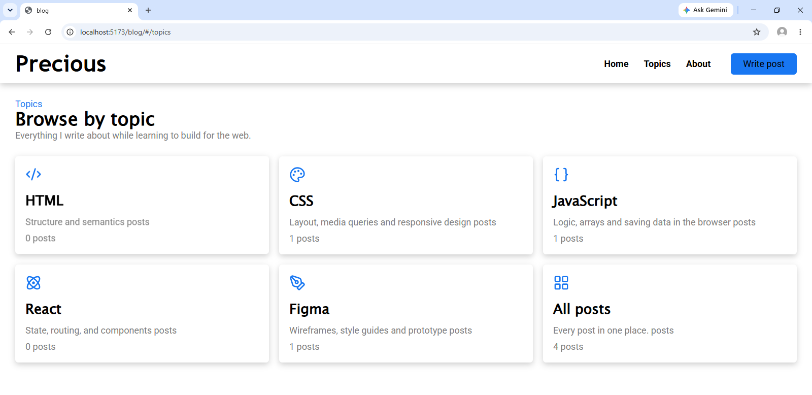
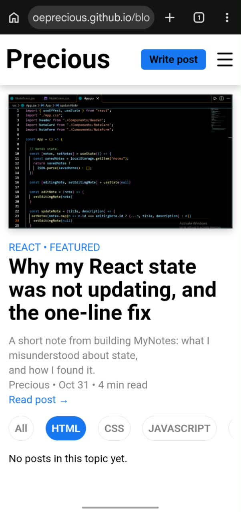

# Precious | A Frontend Blog

A React blog where I write down what I learn while building for the web: HTML, CSS, JavaScript, React and Figma.

This is a **practice project**. I built it to learn how a real blog works like sharing data, dynamic pages, forms, and saving things in the browser, with no backend.

**Live site:** (https://oeprecious.github.io/blog/)



## What you can do

- **Read** a featured post and browse posts as cards.
- **Filter** posts by topic with chips: HTML, CSS, JavaScript, React, Figma.
- **Open a post** on its own page with its own address.
- **Browse topics** and see how many posts each one has.
- **Write a post** with a title, a topic, a cover image and the full text.
- **Save a draft** and pick it up again after a refresh.
- **Use it on a phone**, with a menu that slides in from the right and a dark overlay behind it.



## Pages

| Page                   | What it does                                                              |
| ---------------------- | ------------------------------------------------------------------------- |
| **Home**               | Featured post, topic chips and a grid of post cards                       |
| **Post** (`/post/:id`) | One post with its image, topic, date and full text                        |
| **Topics**             | A card for each topic with a live post count                              |
| **About**              | Who I am, what the blog is about, and links to my CV, GitHub and LinkedIn |
| **Write post**         | Form to publish a post or save a draft                                    |

## Built with

- **React** with **Vite**
- **React Router** (`HashRouter`, so it works on GitHub Pages)
- **lucide-react** for icons
- **Plain CSS** with media queries
- **localStorage** for saved data
- **gh-pages** for deployment

## Concepts I had to learn to build this

This is the part of the project that taught me the most.

### 1. Dynamic routes and `useParams`

The blog has one `Post` page, but every post needs its own address. A route with a colon in it makes part of the URL a variable:

```jsx
<Route path="/post/:id" element={<Post allPosts={allPosts} />} />
```

Each card links to its post by putting the post's `id` in the URL:

```jsx
<Link to={`/post/${post.id}`}>...</Link>
```

Inside `Post`, the `useParams` hook reads that `id` back out of the address, and I use it to find the right post:

```jsx
const { id } = useParams();
const post = allPosts.find((p) => String(p.id) === id);
```

URL values are always text, so I convert the post's `id` to a string before comparing. Without `String(...)`, the numbers never match and the page says "Post not found".

### 2. One source of truth, with lifting state up

The hero, the cards, the Topics counts and the Post page all need the same posts. Instead of copying data into each file, `App` keeps one combined list and passes it down as props:

```jsx
const allPosts = [...newPosts, ...posts];
```

- `posts` is the static starter list in a data file.
- `newPosts` is state for posts I publish, saved in `localStorage`.
- The spread operator joins them, with the newest first.

When a child page needs to change that list, like the Write post form, `App` passes it a **function** (`addPosts`). The form calls it, and `App` updates the state. Data flows down as props, and changes flow up as functions.

### 3. A filter built with state and `.filter()`

The chips set an `activeTopic` state. The cards filter the list by that topic before mapping over it:

```jsx
const filteredCard =
  activeTopic === "All"
    ? allPosts.filter((p) => p.id !== 0)
    : allPosts.filter((item) => item.techStack === activeTopic);
```

The bug I hit here taught me something: I built the filtered list but kept mapping over the original one, so the filter did nothing. The list you map over is the list you see.

### 4. Counts calculated from data, not typed in

On the Topics page, each count is calculated with `.filter()` and `.length`. When I publish a post, its topic's count goes up on its own.

### 5. Saving to the browser with `localStorage`

`localStorage` only stores text, so lists are saved with `JSON.stringify` and read back with `JSON.parse`. State is set up with a function that reads storage first:

```jsx
const [newPosts, setNewPosts] = useState(() => {
  const saved = localStorage.getItem("newPosts");
  return saved ? JSON.parse(saved) : [];
});
```

A `useEffect` with `[newPosts]` at the end saves the list again whenever it changes. I use a different key for each thing, so they can't clash.

### 6. Images in the browser with `FileReader`

You can't save a file in `localStorage`, so the cover image is turned into text (a data URL) with `FileReader.readAsDataURL`. The drop area handles both a click to browse and a drag and drop, using `onDragOver` and `onDrop` with `event.preventDefault()`. Images are limited to 1MB, because `localStorage` only holds about 5MB.

### 7. Drafts that survive a refresh

Save draft stores the form's title, text, topic and image in `localStorage`. When the page loads, the form's state starts from that saved draft, and publishing clears it.

### 8. Responsive layout and a mobile menu

- Media queries for tablet and phone sizes.
- A menu panel that slides in from the right with `transform: translateX()` and a transition.
- State decides whether the panel is open, which icon shows (menu or X), and whether the overlay renders.
- Choosing a link closes the menu.
- CSS Grid with `minmax(0, 1fr)` columns and `overflow-wrap`, so long text can't stretch a card.

## Bugs that taught me things

- **"post is not iterable":** spreading a single object instead of a list.
- **Values in the wrong fields:** passing arguments in a different order from the function's parameters.
- **A card stretching the layout:** a long unbroken word, fixed with `minmax(0, 1fr)`.
- **A blank page on GitHub Pages:** the router's base path, fixed with `HashRouter`.

## Run it locally

You need [Node.js](https://nodejs.org) installed.

```bash
# 1. Clone the repository
git clone https://github.com/oeprecious/blog.git

# 2. Go into the project folder
cd blog

# 3. Install dependencies
npm install

# 4. Start the development server
npm run dev
```

Open the local link shown in your terminal.

## Deployment

```bash
npm run deploy
```

This builds the site and publishes it to the `gh-pages` branch. `base` in `vite.config.js` is set to the repository name, and the Pages source in the repository settings is the `gh-pages` branch.

## Limits to know about

This project has no backend. Everything I publish lives in my own browser's `localStorage`, so other visitors can't see my new posts, and clearing the browser's data removes them. A real blog would need a database and a server.
